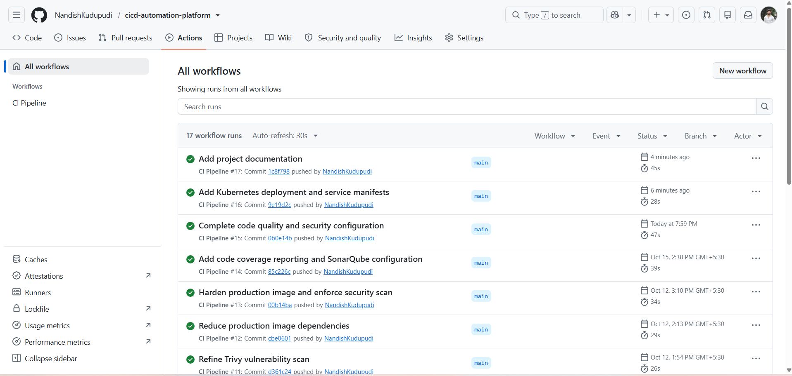
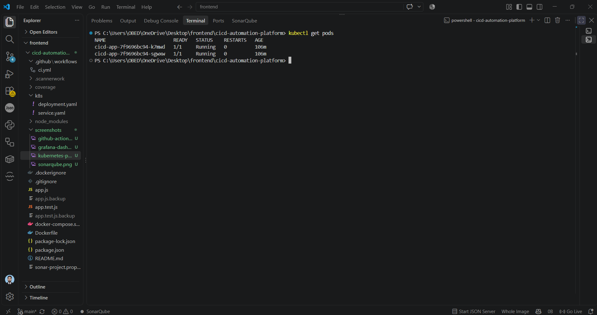
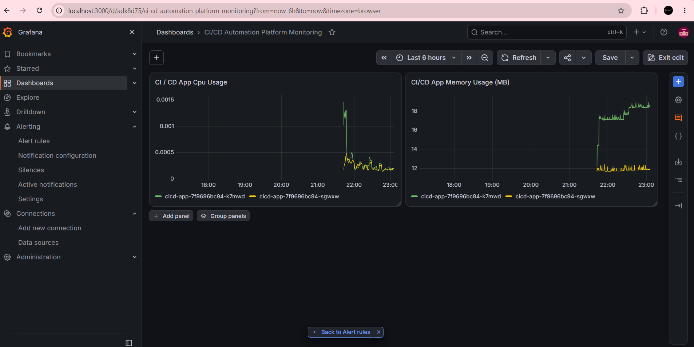
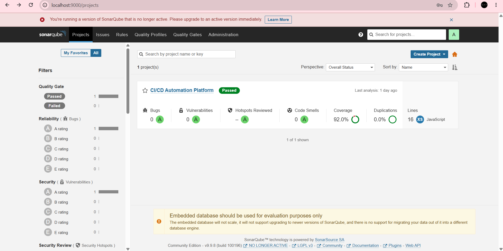
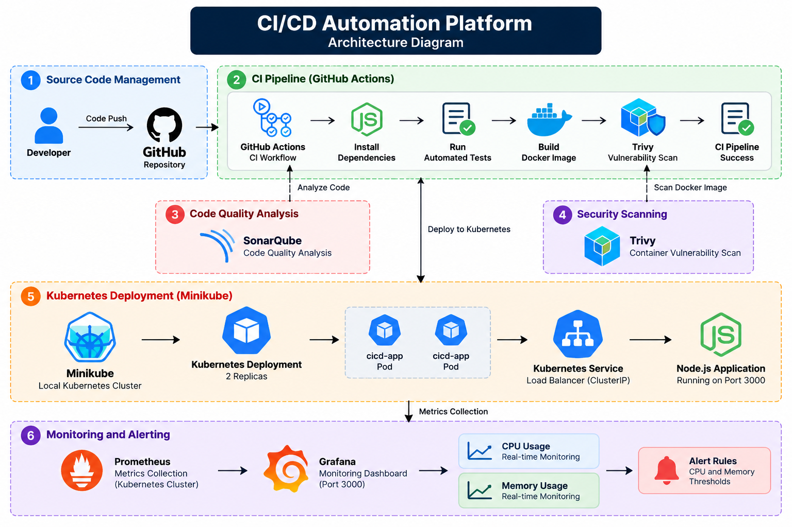

# CI/CD Automation Platform with Kubernetes Monitoring

## Project Overview
A production-style DevOps project that automates application testing, Docker image building, code quality analysis, container deployment, and monitoring using open-source tools.

## Tech Stack
- **Application:** Node.js
- **Version Control:** Git and GitHub
- **CI Pipeline:** GitHub Actions
- **Containerization:** Docker, multi-stage Dockerfile
- **Code Quality:** SonarQube
- **Security Scanning:** Trivy
- **Orchestration:** Kubernetes with Minikube
- **Monitoring:** Prometheus and Grafana
- **Metrics:** CPU and memory usage, pod status

## Architecture

Developer → GitHub → GitHub Actions → Automated Tests → Docker Build → Trivy Security Scan

Local deployment: Docker Image → Minikube Kubernetes Deployment → Kubernetes Service → Application

Monitoring: Kubernetes Metrics → Prometheus → Grafana Dashboard → Alert Rules

## Key Features
- Automated tests triggered by repository changes.
- Docker multi-stage build with a health check.
- Static code analysis using SonarQube.
- Container image vulnerability scanning using Trivy.
- Kubernetes deployment configured with two replicas.
- Readiness and liveness probes for application health.
- Prometheus metrics collection and Grafana CPU/memory dashboards.
- Grafana alert rule configuration with a one-minute pending period.

## Project Structure
```text
cicd-automation-platform/
├── .github/workflows/ci.yml
├── k8s/
│   ├── deployment.yaml
│   └── service.yaml
├── app.js
├── app.test.js
├── Dockerfile
├── .dockerignore
├── package.json
├── package-lock.json
└── README.md
```

## Run Locally
```bash
npm ci
npm test
npm run test:coverage
```

## Build and Run with Docker
```bash
docker build -t cicd-automation-platform:production .
docker run --rm -p 3001:3000 cicd-automation-platform:production
```

Open `http://localhost:3001` to check the application response.

## Deploy to Minikube
```bash
minikube image load cicd-automation-platform:production
kubectl apply -f k8s/
kubectl rollout status deployment/cicd-app
kubectl get pods
kubectl get services
```

## Monitoring
Prometheus collects Kubernetes and container metrics. Grafana visualizes application CPU and memory usage and evaluates configured alert rules.

## Learning Outcomes
- CI/CD pipeline design and troubleshooting.
- Docker image optimization and health checks.
- Kubernetes deployments, services, replicas, and probes.
- Code quality and container security scanning.
- Metrics queries, dashboard design, and alert configuration.

## Limitations
The application and Kubernetes deployment run locally using Minikube. The monitoring setup is intended for local learning and demonstration, not production availability.

## Future Improvements
- Add Jenkins-based pipeline automation.
- Improve security scanning and vulnerability remediation.
- Add deployment rollback automation.
- Add notification delivery testing and further application metrics.

## Project Screenshots

### 1. GitHub Actions CI Pipeline


### 2. Kubernetes Deployment


### 3. Grafana Monitoring Dashboard


### 4. SonarQube Code Analysis



## Architecture Diagram


